<div align="center">

# axiom

**A desktop environment for Wayland compositors. Bring your own apps, build the rest on screen.**

Runs on [Hyprland](https://hypr.land), [niri](https://github.com/YaLTeR/niri) and [sway](https://swaywm.org). Bars, menus, a launcher, notifications, settings, theming, desktop widgets, the lock screen and the login screen are all one application, laid out by dragging and set from the UI.

<a href="https://github.com/axiom-shell/axiom/stargazers"><picture><source media="(prefers-color-scheme: light)" srcset="https://img.shields.io/github/stars/axiom-shell/axiom?style=for-the-badge&color=8c6c3e&labelColor=e1e2e7"></picture></a>
<a href="https://github.com/axiom-shell/axiom/tags"><picture><source media="(prefers-color-scheme: light)" srcset="https://img.shields.io/github/v/tag/axiom-shell/axiom?sort=semver&label=version&style=for-the-badge&color=b15c00&labelColor=e1e2e7"></picture></a>
<a href="https://github.com/axiom-shell/axiom/commits/main"><picture><source media="(prefers-color-scheme: light)" srcset="https://img.shields.io/github/last-commit/axiom-shell/axiom?style=for-the-badge&color=587539&labelColor=e1e2e7"></picture></a>
<a href="#compositors"><picture><source media="(prefers-color-scheme: light)" srcset="https://img.shields.io/badge/Wayland-Hyprland%20%C2%B7%20niri%20%C2%B7%20sway-2e7de9?style=for-the-badge&labelColor=e1e2e7"></picture></a>
<a href="https://quickshell.org"><picture><source media="(prefers-color-scheme: light)" srcset="https://img.shields.io/badge/Quickshell-0.3.2%2B-9854f1?style=for-the-badge&labelColor=e1e2e7"></picture></a>
<a href="LICENSE"><picture><source media="(prefers-color-scheme: light)" srcset="https://img.shields.io/badge/License-MIT-118c74?style=for-the-badge&labelColor=e1e2e7"></picture></a>

[Why axiom](#why-axiom) · [Highlights](#highlights) · [Example setups](#example-setups) · [What's included](#whats-included) · [Compositors](#compositors) · [Install](#installation) · [Docs](#documentation)

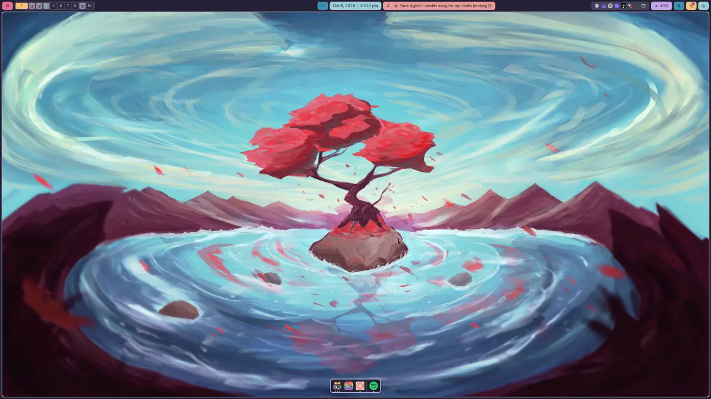

<sub>One shell, infinite desktops, zero edited files. Each is an <a href="#example-setups">example setup</a> you can apply in one click.</sub>

</div>

## Why axiom

Most shells hand you a finished desktop and a page of options to tweak. axiom hands you the pieces and the editors: every bar, page, menu, widget and lock screen is something you design yourself, on screen.

- **You design every surface** - One set of modules builds overlay pages, sidebars, desktop widgets, the lock screen and the login screen, all laid out by dragging. Bars are widgets you pick and style one by one. Changes show live until you save.
- **The whole session, one app** - Login, lock, notifications, polkit, idle, OSDs, the launcher, and settings for Wi-Fi, Bluetooth, audio, monitors, keybinds and input, from one config.
- **Bring your own apps** - No bundled file manager, terminal or browser. Use the ones you like, and axiom themes 22 of them to match (and many more to come!).
- **Any compositor, same desktop** - One config runs on Hyprland, niri and sway, so switching brings your bars, pages, theme and keybinds along.
- **Updates don't fight you** - Your config is validated and migrated between versions, never merged by hand.
- **Easy to share** - An export holds only the look and layout. Monitors, paths and accounts stay behind, and commands come along only if you ask.
- **Simple to try** - By default axiom never edits your compositor's config. It skips any key you already use, and goes away when you remove its one start-up line.

## Highlights

<table>
<tr>
<td width="50%" valign="top">

### Build every surface

Pages, menus, the desktop, even the lock and login screens: drag modules onto a grid and watch it change live.

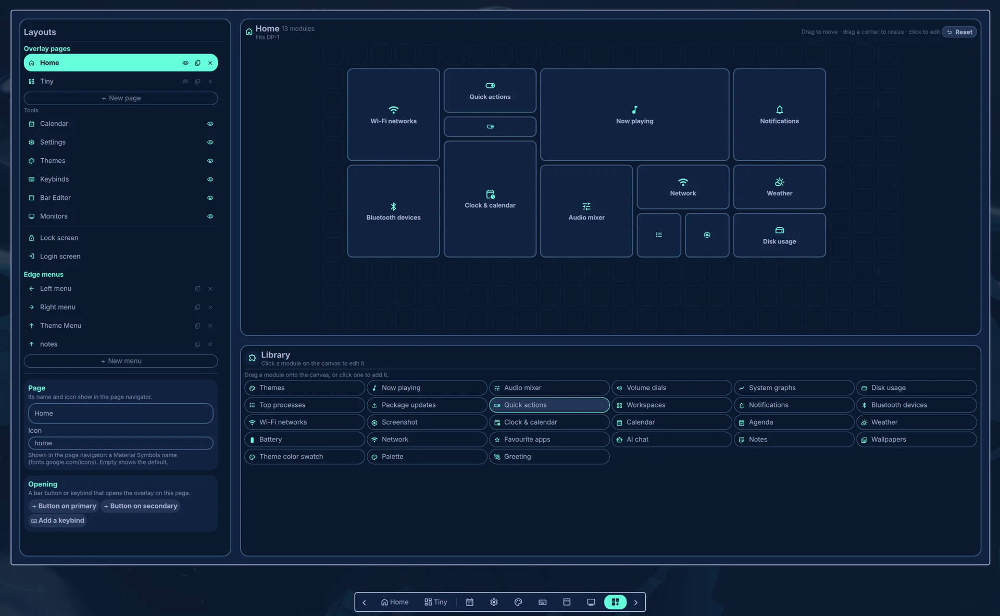

</td>
<td width="50%" valign="top">

### Bars in any style

Solid, floating, pills or powerline, on any edge. Mix and match until it's yours.

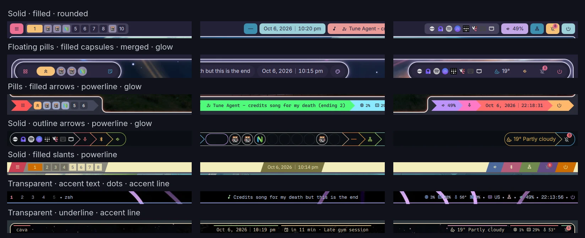

</td>
</tr>
<tr>
<td valign="top">

### Menus that make room

Menus slide out of any edge, over your windows or pushing them aside like a sidebar.

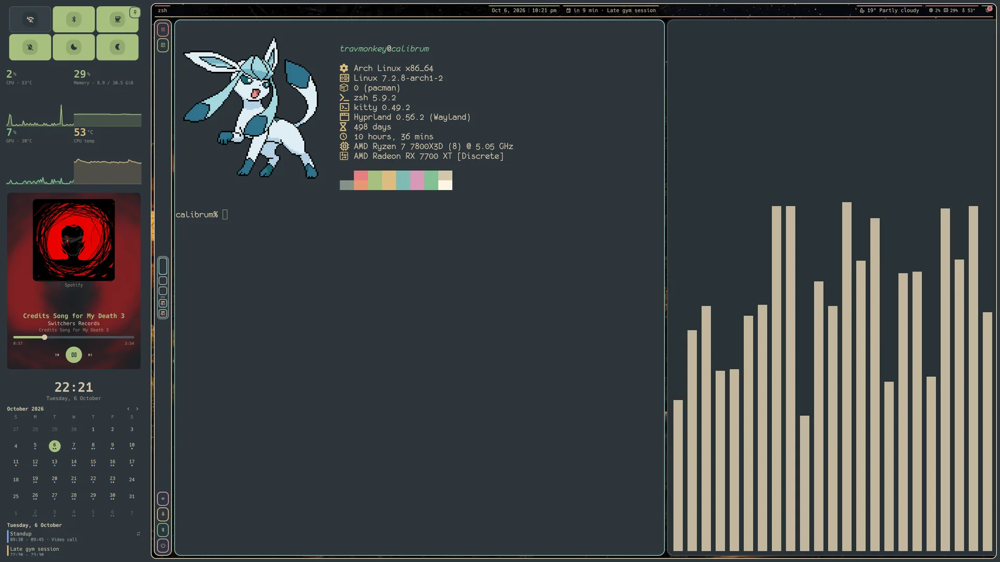

</td>
<td valign="top">

### Workspaces in two dimensions

A grid per monitor or scrolling strips, and everything follows along.

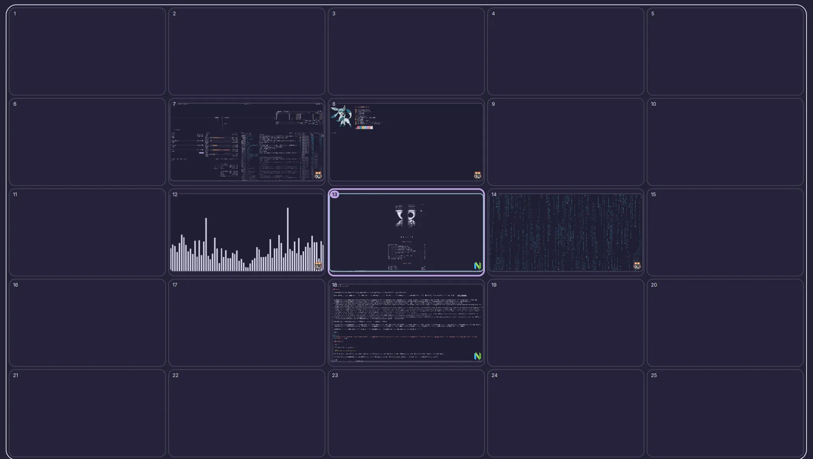

</td>
</tr>
<tr>
<td valign="top">

### A launcher that does everything

Apps, math, emoji, the clipboard, AI chat, and commands for the whole shell.

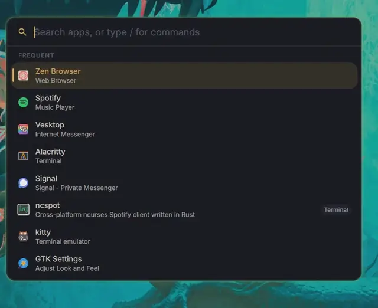

</td>
<td valign="top">

### One theme, every app

42 themes, or one from your wallpaper, carried across 22 of your apps.

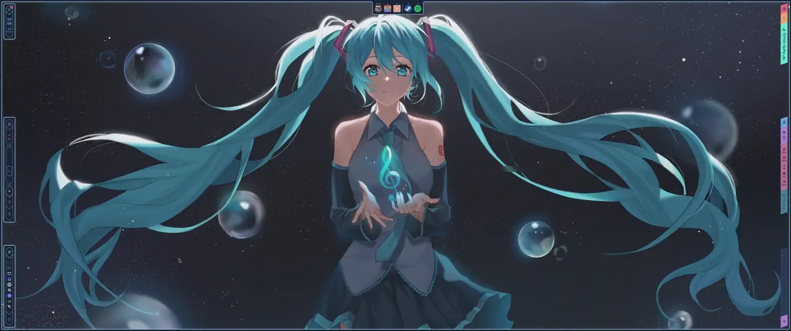

</td>
</tr>
</table>

See **[all the features](docs/features.md)**, with screenshots of every surface.

## Example setups

> [!NOTE]
> **No file was edited by hand.** Each setup was built with axiom's own editors and Settings page, and ships in [`examples/`](examples). Apply one from **Settings → Maintenance** or with `/config example <name>` in the launcher. It changes the look and layout only (wallpapers, monitors, apps and accounts stay yours), and your current setup is saved first.
>
> Your own setup travels the same way: **Settings → Maintenance → Share** exports its look and layout to a file, leaving out monitors, wallpapers, accounts and paths. **Import…** applies anyone's file just as an example applies. Keybinds, apps and commands come along only if you ask, since a shared command runs as you.
>
> **More from the community:** browse and apply setups other people shared at [**community-setups**](https://github.com/axiom-shell/community-setups) from **Settings → Maintenance → Community setups** (or `/config community`), and submit yours there.

<details>
<summary><b>See all nine</b></summary>

| `clean` | `big-pills` | `powerline` |
| :---: | :---: | :---: |
| 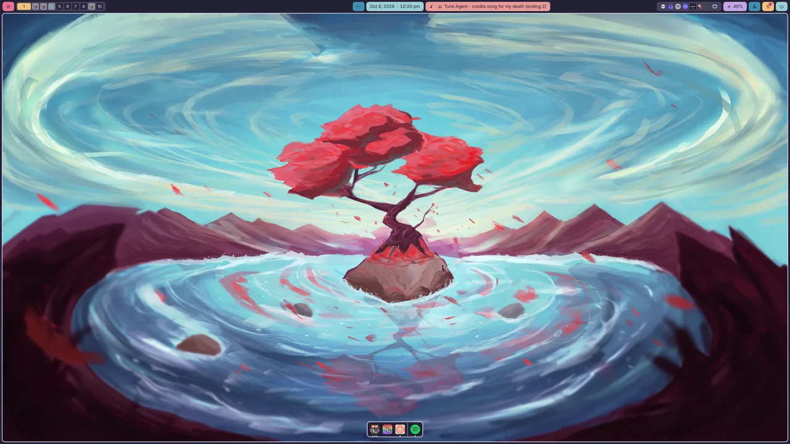 |  | 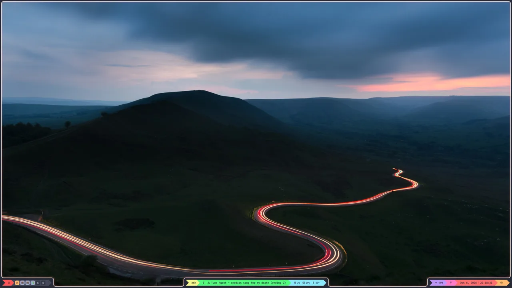 |
| Rosé Pine Moon · solid · filled | Rosé Pine Moon · floating pills · glow | Dracula · bottom pills · powerline |
| **`sidebar`** | **`transparent`** | **`underline`** |
| 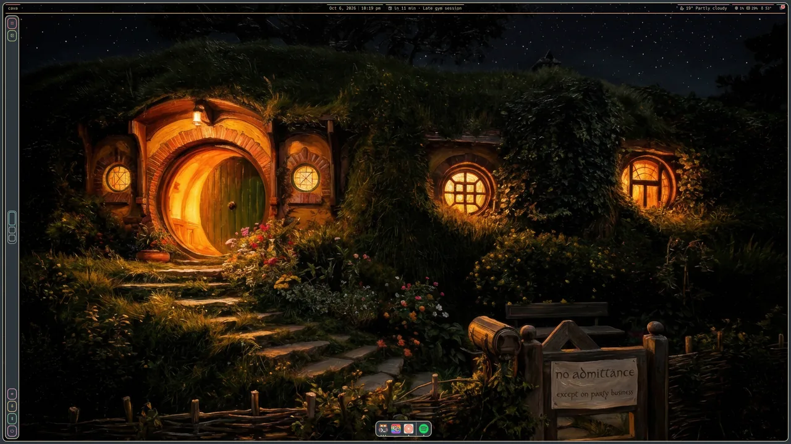 | 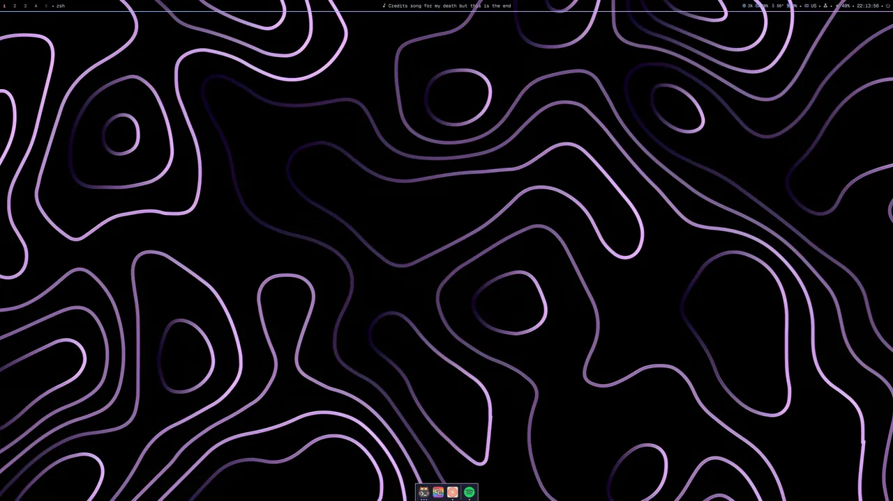 | 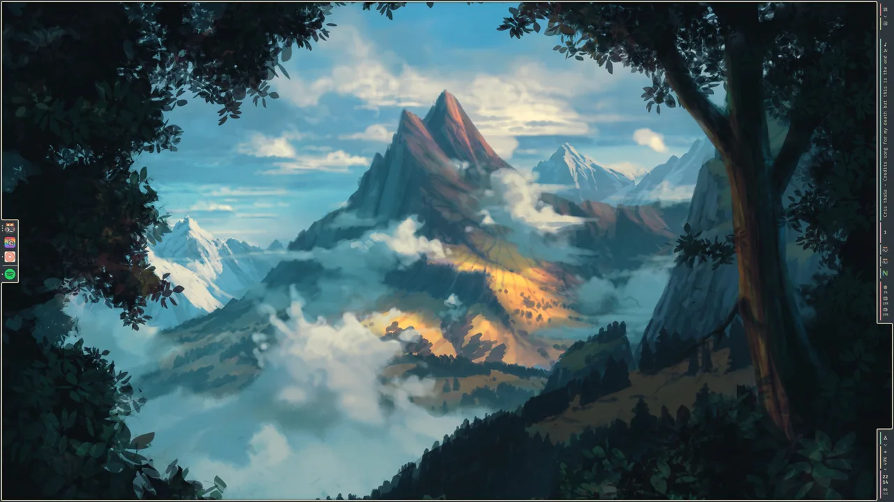 |
| Everforest · floating bar · pinned sidebar | Catppuccin Mocha · transparent · dots | Everforest · right-edge pills · slants |
| **`outline`** | **`basic`** | **`sonar`** |
| 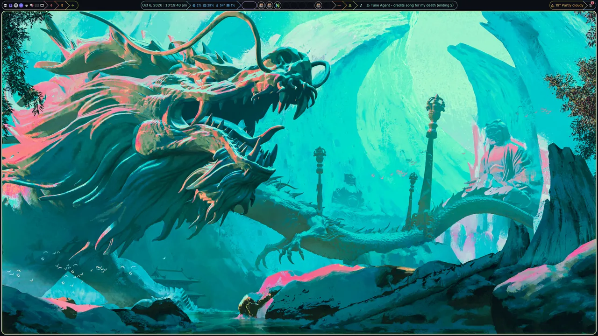 | 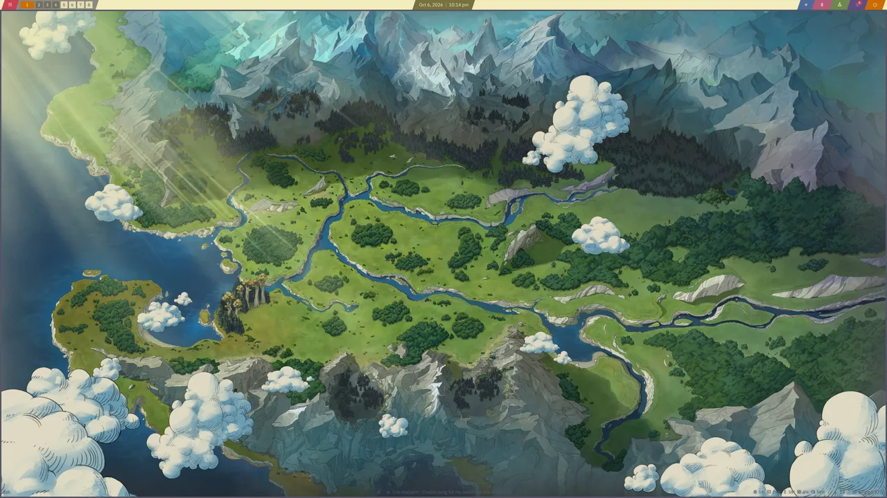 | 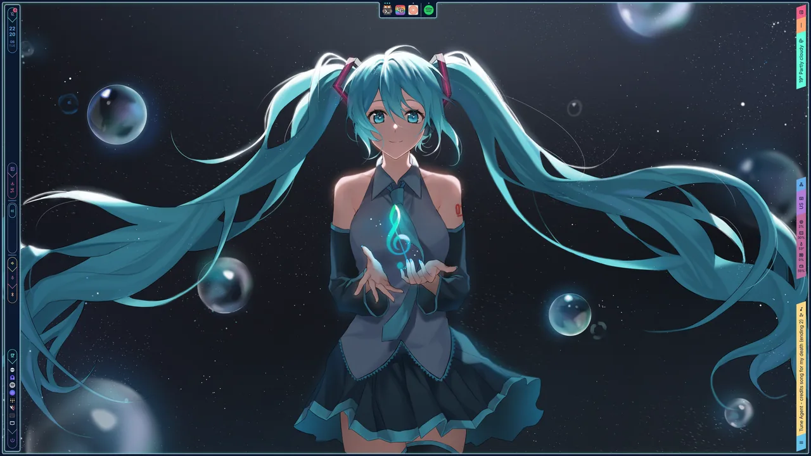 |
| Ayu Dark · outlined arrows · glow | Kanagawa Lotus · two bars · light | Submarine Sonar · both sides · AI chat sidebar |

</details>

## What's included

One repository and one config for the whole desktop:

- **Edge menus** built from 41 modules (media, mixer, system graphs, weather, calendar, notes, todos, AI chat, clipboard, quick actions and more), sliding out of any edge, over your windows or beside them. Build anything with them: a sidebar, a control center, a dynamic island.
- **Overlay** pages from the same modules, full screen.
- **Desktop widgets** from the same modules, under your windows, per monitor.
- **Lock screen** and **login screen** (greetd), laid out from the same modules too.
- **Bars** with 26 widget types, in any style. Their popouts grow out of the bar or the screen border.
- **Workspaces** as a line, a grid per monitor or scrolling strips, plus an overview and **Alt+Tab switcher**.
- **Your compositor, set from the UI:** keybinds, monitors, input, the window look (borders, gaps, rounding, blur, shadows), and optionally the whole config file.
- **Calendar** from CalDAV accounts, `.ics` feeds and calendars kept on your computer, with an editor, reminders and quick add (`/event fri 3pm Dentist`).
- **Theming:** 42 base16 themes or ones generated from your wallpaper, applied to 22 other apps, with a light/dark schedule.
- **Launcher** for apps, windows, math, the clipboard, emoji and `/` commands for the whole shell.
- **Docks** on any edge with pinning and magnification, **OSDs**, notifications, a **polkit** prompt and a power menu.
- **AI chat** (Claude, OpenAI, Gemini or Ollama) in a page, a menu or the launcher.
- **The `axiom` command:** the shell's parent, which restarts it if it crashes and owns your config, and a command line for scripts and keybinds (`axiom launcher toggle`, `axiom lock`, `axiom config set …`).
- A **monitor** layout editor, notes, a todo list, a pomodoro timer, a timer and stopwatch, screenshots and recording, night light, idle, translations, a first-run setup, and **saved configs** you can export, share and import.

## Compositors

axiom talks to the compositor through one layer, so the bar, the overlay, the launcher, theming and the rest are the same everywhere. What differs is what each compositor can do:

| | Hyprland 0.55+ | niri 26.04+ | sway 1.12+ |
| --- | :---: | :---: | :---: |
| Keybinds, monitors, input, window look | ✓ | ✓ | ✓ |
| Workspace grid per monitor | ✓ | (niri's own workspaces) | ✓ |
| Scrolling strips | any monitor | every monitor | |
| Blur behind the shell | ✓ | ✓ | with SwayFX |
| Live window previews | ✓ | | |
| The login screen | ✓¹ | ✓¹ | ✓¹ |

<sub>¹ The login screen runs in a compositor of its own, whatever compositor you use: sway, or Hyprland when sway isn't installed.</sub>

Your config moves between them as it is. Log in to another compositor and your bars, pages, menus, theme and keybinds are already there; whatever only one compositor understands waits quietly in the config until you're back on it. Settings a compositor can't use are left out of the settings page rather than shown and ignored. Running something else? The bar, launcher, notifications and most of the shell still work on any Wayland compositor with layer-shell; only the compositor-specific parts go missing.

## Installation

On Arch Linux, Fedora, or a distribution based on either (CachyOS, EndeavourOS, Manjaro, Nobara, …), run the installer:

```bash
curl -fsSL https://raw.githubusercontent.com/axiom-shell/axiom/main/install.sh | bash
```

It uses the compositor you're running or have installed, or asks which one to install (Hyprland, niri or sway). Before anything runs as root it shows each command and why: one `sudo pacman` or `sudo dnf`, plus on Fedora each COPR it needs. It asks before adding axiom's start-up line to your compositor's config, and backs that file up first. `--dry-run` prints what it would do and changes nothing. On first start, a short setup walks you through the look, monitors, workspaces, apps and integrations.

<details>
<summary><b>By hand</b>: on another distribution, or if you'd rather not pipe to bash</summary>

Install the requirements: a compositor (above), [Quickshell](https://quickshell.org) 0.3.2+, the [Material Symbols](https://fonts.google.com/icons) font, `git`, `go`, `jq`, `curl` and `python3`. Optional features have their own dependencies, listed in [the installation guide](docs/installation.md#requirements).

Clone into Quickshell's config directory, build the `axiom` binary (the shell's parent), and try it with `axiom run`:

```bash
git clone https://github.com/axiom-shell/axiom.git ~/.config/quickshell/axiom
cd ~/.config/quickshell/axiom && scripts/generate.sh && go -C backend build -o ~/.local/bin/axiom ./cmd/axiom
```

To start it with your session, add one line to your compositor's config (a second `axiom run` on the same display exits at once):

| Compositor | File | Line |
| --- | --- | --- |
| Hyprland | `~/.config/hypr/hyprland.lua` | `hl.on("hyprland.start", function() hl.exec_cmd("axiom run") end)` |
| niri | `~/.config/niri/config.kdl` | `spawn-sh-at-startup "axiom run"` |
| sway | `~/.config/sway/config` | `exec axiom run` |

</details>

By default axiom runs *detached*: it applies its keybinds and settings at runtime and never writes your compositor's config. If you'd rather keep them in a file, it can write one you include, or manage the whole config for you (see [Compositor modes](docs/installation.md#compositor-modes)).

## Documentation

- **[Features](docs/features.md):** every surface in detail, with screenshots
- **[Installation and setup](docs/installation.md):** requirements, compositor modes, updates, idle and locking, the login screen
- **[Keybinds, IPC and launcher](docs/usage.md):** keybind presets, IPC targets and every launcher command
- **[Configuration](docs/configuration.md):** the config file, backups, themes, translations, troubleshooting
- **[Developer docs](docs/dev/README.md):** how every service and surface works, for contributors

## Contributing

Contributions are welcome. [Open an issue](https://github.com/axiom-shell/axiom/issues/new/choose) and pick the form that fits (a bug, a feature, a bar widget or module, an app to theme, a compositor or distribution, a translation), or fork the repository and open a pull request against `main`. CI runs the same checks as `scripts/check_all.sh`.

[CONTRIBUTING.md](CONTRIBUTING.md) covers setting up, the workflow, and where in the docs to start. The shell is QML with no build step: it reloads the moment you save. The `axiom` binary that runs it is Go, and `axiom dev on` rebuilds it as you edit.

**Looking to help?** axiom is built and tested on one machine, so people running Hyprland, sway or niri on other hardware, packagers (`axiom-shell` for the AUR, COPR and Nix) and translators are especially welcome: see [Help wanted](https://github.com/orgs/axiom-shell/discussions/67), the [translations tracker](https://github.com/axiom-shell/axiom/issues/66) and the [good first issues](https://github.com/axiom-shell/axiom/labels/good%20first%20issue).

## Roadmap

- **Other Wayland compositors**, beyond Hyprland, sway and niri
- **More widgets** for bars and overlay pages
- **More styles** for bars, widgets and menus
- **More translations**
- **Performance Improvements**
- **Fewer dependencies**: the `axiom` binary taking over what helper tools and scripts do today (clipboard history, idle, night light, typing, the Python scripts)
- **Installing without Go**: the installer and updates using each release's prebuilt `axiom` binary
- **Community Config Library and Showcase**
- **Packages**: `axiom-shell` and `axiom-shell-git` for the AUR and COPR, and Nix. The AUR packages are ready but wait on AUR account registration reopening ([#76](https://github.com/axiom-shell/axiom/issues/76))

## Acknowledgments

axiom is built on:
- [Hyprland](https://hypr.land), [niri](https://github.com/YaLTeR/niri) and [sway](https://swaywm.org), the compositors it runs on
- [Quickshell](https://quickshell.org), the QML toolkit every surface is written in, and without which axiom couldn't exist
- [Go](https://go.dev), which the `axiom` binary is written in, with [goja](https://github.com/dop251/goja) (running the old config migrations) and [gopher-lua](https://github.com/yuin/gopher-lua) (reading Hyprland's Lua configs)
- [Material Symbols](https://fonts.google.com/icons), the icons

The static themes are ports of [Catppuccin](https://catppuccin.com), [Gruvbox](https://github.com/morhetz/gruvbox), [Gruvbox Material](https://github.com/sainnhe/gruvbox-material), [Solarized](https://ethanschoonover.com/solarized/), [Tokyo Night](https://github.com/tokyo-night/tokyo-night-vscode-theme), [Rosé Pine](https://rosepinetheme.com), [Nord](https://www.nordtheme.com) (Nord Light after [threddast's](https://github.com/tinted-theming/schemes/blob/spec-0.11/base16/nord-light.yaml)), [Dracula and Alucard](https://draculatheme.com), [Everforest](https://github.com/sainnhe/everforest), [Kanagawa](https://github.com/rebelot/kanagawa.nvim), [One Dark/Light](https://github.com/atom/atom/tree/master/packages), [Ayu](https://github.com/ayu-theme/ayu-colors), [Nightfox](https://github.com/EdenEast/nightfox.nvim), [GitHub](https://github.com/primer/github-vscode-theme) and [Oxocarbon](https://github.com/nyoom-engineering/oxocarbon.nvim), most by way of [tinted-theming](https://github.com/tinted-theming/schemes)'s base16 palettes. Submarine Sonar is axiom's own.

And thanks to the Hyprland desktops that inspired it: [illogical-impulse](https://github.com/end-4/dots-hyprland), [caelestia-dots](https://github.com/caelestia-dots) and [JaKooLit's Hyprland-Dots](https://github.com/JaKooLit/Hyprland-Dots).

## Use of AI

Axiom is developed with AI assistance. I design the architecture and systems, and AI-written code is reviewed before it lands, held to the same standards as every other contribution, and checked by CI using the same linting, structural checks, and unit tests.

The repository contains extensive shared engineering instructions, subsystem documentation, development safeguards, and automated checks and tests. These rules are documented openly in AGENTS.md.

AI assistance is part of my development workflow, not a substitute for architectural decisions, verification, or responsibility for the project.

## License

[MIT](LICENSE)
