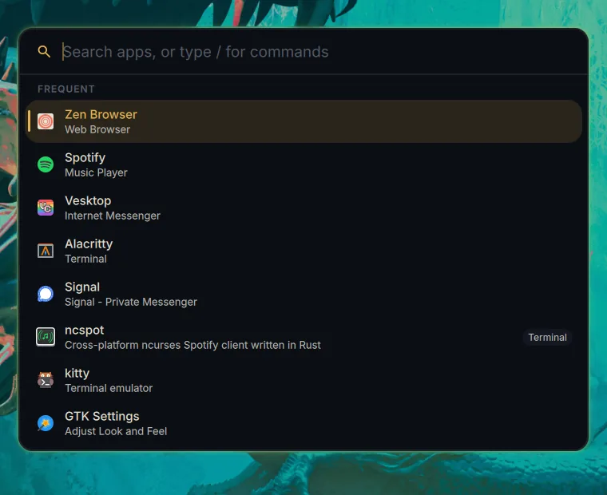
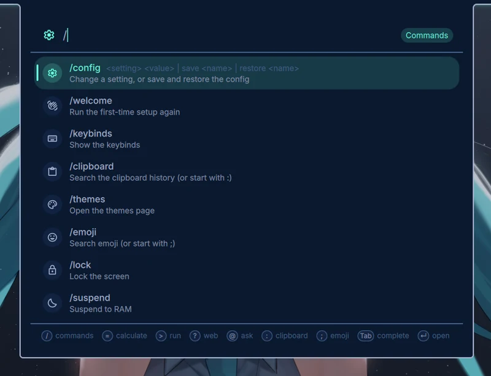
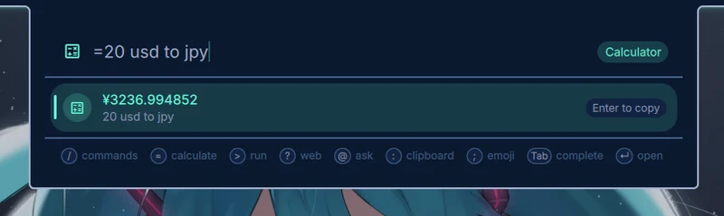
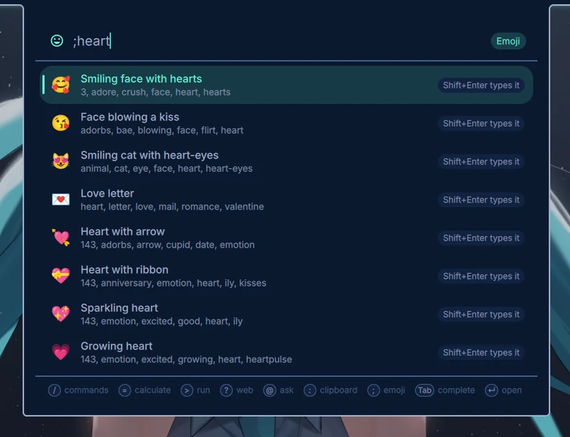

# Keybinds, IPC and launcher

[README](../README.md) · [Features](features.md) · [Installation](installation.md) · [Keybinds, IPC and launcher](usage.md) · [Configuration](configuration.md)

## Keybinds

Keybinds are edited on the overlay's **Keybinds** page. Filter by section or modifier, sort, search, and record a key by pressing it.

A bind can run:
- any IPC action below
- a window action (focus, move, resize, close, fullscreen, floating, special workspaces, mouse drag)
- a raw command in the compositor's own language: a Hyprland dispatcher as Lua (`hl.dsp.layout("swapsplit")`), a sway command or a niri action. It's kept for the compositor it was written for, and skipped (with a warning) on the others
- a command

It can repeat while held, work while locked, or fire on release. A description like `Workspace: Switch left` puts the bind in its own section on the page.

**Presets** add a set of binds in one click, skipping any key you already use:

| Preset | Binds |
| --- | --- |
| Essentials | Launcher, overlay, workspace overview, power menu and lock |
| Workspaces 1–N | <kbd>Super</kbd> + number goes to a workspace, with <kbd>Shift</kbd> it takes the window along |
| Grid with WASD | <kbd>Super</kbd> + <kbd>W</kbd> <kbd>A</kbd> <kbd>S</kbd> <kbd>D</kbd> moves around the grid, with <kbd>Shift</kbd> it takes the window along |
| Grid with arrows / Previous and next | <kbd>Super</kbd> + <kbd>Ctrl</kbd> + arrows moves around the grid (or steps through workspaces), with <kbd>Shift</kbd> it takes the window along |
| Window management | <kbd>Super</kbd> + <kbd>H</kbd> <kbd>J</kbd> <kbd>K</kbd> <kbd>L</kbd> moves focus, with <kbd>Shift</kbd> the window, with <kbd>Alt</kbd> resizes it; close, fullscreen, floating and mouse drag |
| Window switcher | <kbd>Alt</kbd> + <kbd>Tab</kbd> steps through your windows, most recently used first, with <kbd>Shift</kbd> backwards; releasing <kbd>Alt</kbd> picks |
| Strips (with a strip monitor) | <kbd>Super</kbd> + <kbd>[</kbd> / <kbd>]</kbd> swaps columns, <kbd>Super</kbd> + <kbd>=</kbd> / <kbd>-</kbd> steps the width, <kbd>Super</kbd> + <kbd>Ctrl</kbd> + <kbd>F</kbd> fits the visible columns, <kbd>Super</kbd> + scroll moves focus along the strip |
| Media keys | Volume, mute, brightness and playback keys, through axiom so the OSD shows |

The page only offers actions your compositor can do. In managed mode, **Merge** moves the binds from your own files in the compositor's `user/` folder onto this page.

## IPC

Every surface can be controlled over Quickshell IPC, so you can bind it to anything:

```bash
qs -c axiom ipc call <target> <function>
```

<details>
<summary><b>IPC targets</b></summary>

| Target | Functions |
| --- | --- |
| `overlay` | `open`, `close`, `toggle`, `page <type>` |
| `edgeMenu` | `open <id>`, `close <id>`, `toggle <id>`, `pin <id>`, `unpin <id>`, `list`, `edit` |
| `dock` | `open <id>`, `close <id>`, `toggle <id>` (no id: every dock) |
| `appLauncher` | `open`, `close`, `toggle`, `search <text>` |
| `powermenu` | `open`, `close`, `toggle` |
| `workspaceOverlay` | `open`, `hide`, `toggle` |
| `workspaces` | `go <id>`, `move <id>`, `moveSilent <id>`, `left`, `right`, `up`, `down`, `step <direction> <mode>`, `nth <n> <mode>`, `reconcile` |
| `windowSwitcher` | `next`, `previous`, `commit`, `cancel` (for scripts: the Alt+Tab bind doesn't need them) |
| `idleInhibit` | `enable`, `disable`, `toggle`, `status` |
| `nightLight` | `enable`, `disable`, `toggle`, `status` |
| `brightness` | `up`, `down`, `set <percent>`, `dim <percent>`, `dimBy <percent>`, `undim` |
| `screenshot` | `take <region\|window\|screen>`, `cancel` |
| `screenRecord` | `toggle`, `enable`, `disable`, `status` |
| `wallpaper` | `next` |
| `monitors` | `open`, `keep`, `revert`, `identify` |
| `onboarding` | `open`, `close`, `goTo <step>`, `reset` |
| `lockscreen` | `lock` |
| `greeter` | `open` (its settings), `preview` (the login screen's layout, on screen) |
| `notifications` | `clear`, `toggleDnd` |
| `selfUpdate` | `check`, `update`, `open` |
| `chat` | `open`, `newChat`, `ask <text>`, `settings` |
| `calendar` | `open`, `newEvent`, `sync`, `add <text>` (as `/event`) |
| `todo` | `add <text>`, `toggle <text>`, `list`, `count`, `clearCompleted` |
| `pomodoro` | `start`, `pause`, `toggle`, `skip`, `stop`, `reset`, `status` |
| `stopwatch` | `timer <duration [label]>`, `toggleTimer`, `resetTimer`, `toggle`, `lap`, `reset`, `status` |
| `audio` | `volumeUp`, `volumeDown`, `toggleMute`, `toggleMicMute` |
| `media` | `playPause`, `next`, `previous`, `stop` |
| `popouts` | `list` (debugging: every open popout's claim and footprint) |

</details>

To bind them in your compositor's own config instead, run the same command. On Hyprland, a `"Section: Label"` description also sets where the bind appears on the Keybinds page:

```lua
-- hyprland.lua
hl.bind("SUPER + SPACE", hl.dsp.exec_cmd("qs -c axiom ipc call appLauncher toggle"), { description = "Axiom: App launcher" })
```

```kdl
// niri config.kdl, inside binds { }
Mod+Space hotkey-overlay-title="Axiom: App launcher" { spawn-sh "qs -c axiom ipc call appLauncher toggle"; }
```

```
# sway config
bindsym $mod+space exec qs -c axiom ipc call appLauncher toggle
```

## Launcher

Plain text searches apps and open windows. When the text is math, the result shows first, and a web search comes last. A prefix picks one kind of search:

| Prefix | Does |
| --- | --- |
| `/` | Shell commands (list below) |
| `=` | Calculator (qalc: math, units, currencies; convert with `to`, as in `=12 usd to eur`). Enter copies the result |
| `>` | Runs a shell command. Shift+Enter runs it in your terminal |
| `?` | Web search, with the engine set in Settings |
| `@` | Asks the overlay's chat, in a new conversation |
| `:` | Clipboard history. Shift+Enter removes an entry |
| `;` | Emoji, searched by name and keyword. Enter copies one, Shift+Enter also types it (with `wtype`) |

| Apps | Commands | Calculator | Emoji |
| :---: | :---: | :---: | :---: |
|  |  |  |  |

<kbd>Tab</kbd> completes a command or its argument. Commands that change something you can see, like the theme, volume or wallpaper, keep the launcher open, so you can try several. `logout`, `reboot` and `poweroff` ask for a second <kbd>Enter</kbd>. Most commands have aliases (`/overview`, `/cal`, `/set`, …), which `/help` lists.

| Group | Commands |
| --- | --- |
| **Session** | `/lock` `/suspend` `/hibernate` `/logout` `/reboot` `/poweroff` `/power` |
| **Pages** | `/overlay [page]` `/settings` `/themes` `/bar` `/keybinds` `/layouts` `/menus` `/monitors` `/workspaces` `/calendar` |
| **Look** | `/theme <name>` `/dark` `/light` `/mode` `/wallpaper <file\|Random>` `/nextwallpaper` `/generate` `/nightlight` |
| **Audio and media** | `/volume <n\|+n\|-n>` `/mute` `/mic` `/output <device>` `/input <device>` `/play` `/next` `/prev` |
| **Connectivity** | `/wifi [on\|off]` `/bluetooth [on\|off]` `/connect <device>` |
| **Calendar and notes** | `/event <when> <title>` `/notes [text]` `/todo [text]` `/pomodoro [start\|pause\|skip\|stop]` `/timer <duration> [label]` `/stopwatch [start\|pause\|lap\|reset]` |
| **Searches** | `/calc` `/run` `/web` `/clipboard` `/emoji` `/chat [conversation]` |
| **Shell** | `/config <setting> <value>` `/config save <name>` `/config restore <name>` `/config example <name>` `/update` `/welcome` `/reload` `/help` |
| **Other** | `/dnd [on\|off]` `/clear` `/caffeine [on\|off]` `/ws <n>` `/screenshot <region\|window\|screen>` `/record` |

Every provider can be switched off under **Settings → Launcher**. The same page sets:
- the launcher's size, hidden apps, terminal and search engine
- where it opens: floating (centred or in the upper third), or attached to the top or bottom edge like the other edge popouts
- whether the search field sits above or below the results
